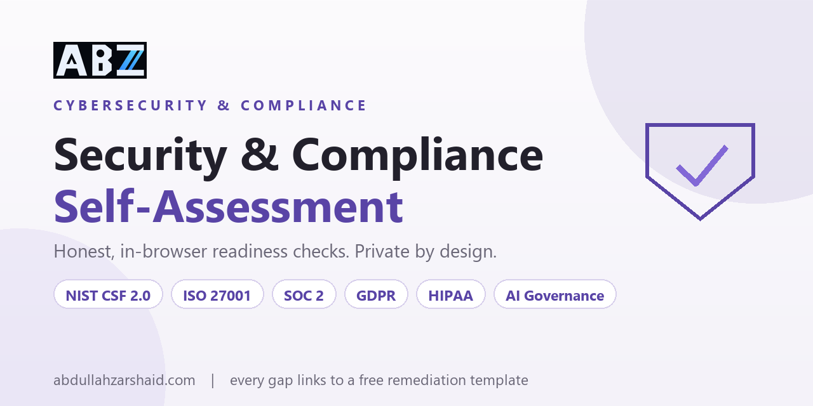

# Security and Compliance Self-Assessment

**Run a free, honest readiness self-assessment for the framework you care about, entirely in your browser.**

<p align="center">
  <a href="https://abdullahzarshaid.github.io/security-assessment-tools/"><b>▶ Open the live tool</b></a>
  &nbsp;·&nbsp;
  <a href="https://abdullahzarshaid.github.io/grc-documentation-kit/">GRC Documentation Kit</a>
  &nbsp;·&nbsp;
  <a href="https://abdullahzarshaid.com">abdullahzarshaid.com</a>
</p>



Seven readiness assessments, from a plain-language starting point to framework-aligned reviews. You rate each prompt on a five-point, evidence-based scale, and the tool shows you where you stand by area, lists the highest-impact gaps first, and links every gap to an open remediation template you can actually use.

## Why this one is different

- **Private by design.** No account, no server, no tracking. Your answers are stored only in your own browser so you can come back to them, and you can clear them at any time.
- **Honest scoring.** Prompts you mark *unknown*, and items you *exclude*, are shown separately and are never counted as passes. The result is a conversation starter for your own team, not an audit or a certification.
- **Every gap is actionable.** Each gap links straight to a matching remediation template in the open [GRC Documentation Kit](https://abdullahzarshaid.github.io/grc-documentation-kit/), so you leave with a next step, not just a number.
- **Original content.** The prompts are original readiness questions, not reproduced standards text.

## The assessments

| Assessment | Prompts | Starting point for |
|---|---|---|
| Security fundamentals | 12 | Any small business or product team |
| NIST CSF 2.0 readiness | 24 | Organising a programme around the six CSF functions |
| ISO 27001 preparation | 12 | Defining or improving an ISMS |
| SOC 2 evidence readiness | 12 | A service organization heading into a SOC 2 examination |
| GDPR readiness | 18 | Any team that processes personal data |
| HIPAA readiness | 16 | A covered entity or business associate handling health data |
| AI governance readiness | 12 | Teams using or building AI features |

## How the score works

The index is an equal-weight, selected-state measure:

```
index = (sum of your numeric ratings) / (number of rated prompts × 3) × 100
```

The five-point scale is: *Not in place (0)*, *Partly in place (1)*, *Documented and routinely followed (2)*, *Reviewed using evidence (3)*, plus *Unknown* and *Excluded*, which are reported but never scored. Scores across different frameworks are not comparable, by design.

## Run it locally

It is a static site with no build step and no dependencies.

```bash
git clone https://github.com/abdullahzarshaid/security-assessment-tools.git
cd security-assessment-tools
python -m http.server 8080
# then open http://localhost:8080
```

## What this is not

This tool does not test your systems, read any of your data, or make a compliance determination. It is a structured self-assessment to help you decide where to focus. For authoritative outcomes, read the framework itself and use competent independent review where it matters.

## License

Content and code are released under the [MIT License](LICENSE). Use it, adapt it, build on it.

---

Built by [Abdullah Bin Zarshaid](https://abdullahzarshaid.com) .
Questions or feedback: abdullahbinzarshaid@gmail.com
